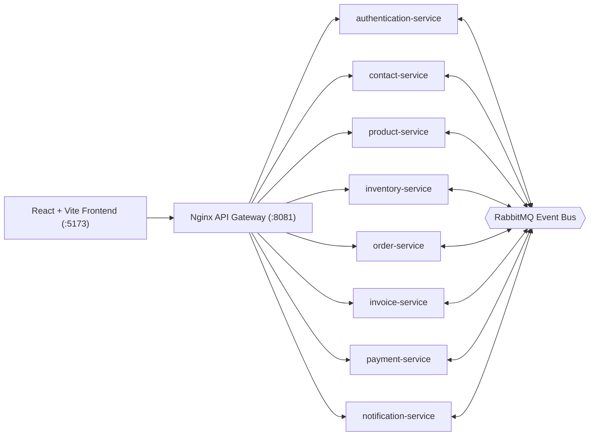

# ERP Microservices Platform

A modular Enterprise Resource Planning (ERP) system built with a **Symfony 8.1 (PHP 8.4+)** microservices backend, a **React + TypeScript + Vite** frontend, and **Docker Compose** orchestration.

## Architecture Overview



- **Database-per-service**: Each microservice owns its own isolated database (MySQL 8.4 or PostgreSQL 16).
- **Synchronous communication**: Client requests enter through the Nginx API Gateway (`infrastructure/gateway/nginx.conf`); internal HTTP calls connect `order-service` to `contact-service` and `product-service`, `notification-service` to `authentication-service`, and the gateway to `authentication-service` for JWKS/public keys.
- **Asynchronous communication**: Domain events flow over **RabbitMQ** via Symfony AMQP Messenger, backed by an `OutboxEvent` pattern in services such as `order-service`, `payment-service`, and `contact-service`.

## Services

### Implemented Backend Services (`services/`)

| Service | Responsibility | Gateway Route(s) | Database |
|---|---|---|---|
| `authentication-service` | Authentication, JWT/JWKS, user directory | `/api/authenticator/` | MySQL 8.4 |
| `contact-service` | Customers, suppliers, status & blacklisting | `/api/contacts` | MySQL 8.4 |
| `product-service` | Product catalog, categories, brands, units, media | `/api/products` | MySQL 8.4 |
| `inventory-service` | Stock levels, warehouses, movements & reservations | `/api/inventories` | MySQL 8.4 |
| `order-service` | Sales and purchase orders | `/api/orders` | MySQL 8.4 |
| `invoice-service` | Invoicing & billing | `/api/invoices` | PostgreSQL 16 |
| `payment-service` | Payments, payment plans, installments, allocations, reminders | `/api/payments`, `/api/payment-plans`, `/api/installments`, `/api/reminders`, `/api/allocations`, `/api/settings` | MySQL 8.4 |
| `notification-service` | Notification dispatch, channels & preferences | `/api/notifications` | MySQL 8.4 |

> **Planned / Placeholder Directories**: `aiAssistant-service`, `mcp-service`, `reporting-service` (diagrams available in `diagrams/reporting-service/`), and `websiteBuilder-service` exist under `services/` without service implementations yet.

### Infrastructure (`infrastructure/` & `docker-compose.infra.yml`)

- **API Gateway (`api-gateway`)**: Nginx reverse proxy routing `/api/*` traffic to `*-service-web` containers and exposing `/health`.
- **Service Discovery (`autodiscovery`)**: HashiCorp Consul (`-dev` mode) on port `8500`.
- **Message Broker (`rabbitmq`)**: RabbitMQ 4 Management (`5672` AMQP, `15672` Management UI).
- **Cache (`cache-redis`)**: Redis 7 Alpine with AOF persistence.

### Frontend (`frontend/`)

- **Stack**: React 19, TypeScript, Vite, Tailwind CSS v4, shadcn/ui + Base UI, React Router, Axios, TanStack Table, Recharts.
- **Tooling & Testing**: ESLint, Vitest, Playwright, and Storybook (`pnpm test`, `pnpm lint`, `pnpm build`, `pnpm storybook`).
- **Routes**: Sign-in (`/`), sign-up (`/signup`), and protected `/dashboard/*` views for contacts, products, inventory, invoices, payments, payment plans, installments, allocations, reminders, notifications (including preferences & admin), and settings.

## Getting Started

### Prerequisites

- Docker & Docker Compose
- Node.js & `pnpm` (optional, for running frontend scripts outside Docker)

### Run the Full Stack

1. Review or adjust environment variables in `.env` (for example `API_GATEWAY_PORT`, database credentials, and RabbitMQ credentials).
2. Start the services from the repository root:

   ```bash
   docker compose up --build
   ```

3. Access the running services:
   - **Frontend**: `http://localhost:5173`
   - **API Gateway**: `http://localhost:8081` (or the port set in `API_GATEWAY_PORT`, default `8080` if unset)
   - **RabbitMQ Management**: `http://localhost:15672`
   - **Consul UI**: `http://localhost:8500`

### Local Frontend Development

```bash
cd frontend
pnpm install
pnpm dev
```

Vite proxies `/api/*` requests to `VITE_API_PROXY_TARGET` (see `frontend/.env.example`).

## Repository Structure

```text
.
├── docker-compose.yml            # Root compose file including infra, frontend, and services
├── docker-compose.*.yml          # Per-service & infrastructure compose definitions
├── infrastructure/               # Nginx gateway, Consul autodiscovery, base configs
├── services/                     # Symfony 8.1 microservices
├── frontend/                     # React + TypeScript + Vite dashboard application
├── diagrams/                     # Architecture, sequence, state, class & data-flow diagrams
└── design/                       # Design system tokens, .pen files & UI audits
```

## Documentation & Diagrams

- System context, sync HTTP dependencies, async RabbitMQ event flows, and JSON payload contracts are documented in [`diagrams/data-flow/README.md`](diagrams/data-flow/README.md).
- Per-service architecture, class, state, and sequence diagrams live under `diagrams/<service-name>/`.
